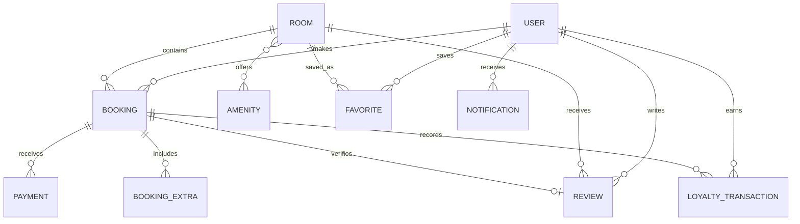

# StayEase

StayEase is a Flask hotel reservation system with a responsive vanilla JavaScript single-page website and a persistent REST API. SQLite is the zero-configuration default; PostgreSQL and MySQL adapters are included for deployments that set `DATABASE_URL`. The app includes guest accounts, room search, server-side quotes and reservations, mock payments, cancellation and refund rules, reviews, favorites, loyalty, notifications, and an admin dashboard.

## Setup

Python 3.10 or newer is required. From the project folder:

    python -m venv .venv
    .venv\Scripts\Activate.ps1
    python -m pip install -r requirements.txt
    Copy-Item .env.example .env
    .venv\Scripts\python.exe -m flask db upgrade
    .venv\Scripts\python.exe -m flask seed
    .venv\Scripts\python.exe -m flask run

The site is served at http://127.0.0.1:5000. The seed command creates the schema if needed and inserts 12 demo users, 20 rooms, 9 amenities, 4 promo codes, 32 historical reservations, payments, and reviews. It is safe to run after seeding.

To rebuild the demo database, run `.venv\Scripts\python.exe -m flask reset-db`. To run the tests, run `.venv\Scripts\python.exe -m pytest -q`.

`DATABASE_URL` accepts standard `postgresql://...` and `mysql://...` URLs and selects the included Psycopg or PyMySQL driver. Set it in `.env` before running migrations. The development default remains `sqlite:///stayease.db`.

For production, set strong SECRET_KEY and JWT_SECRET_KEY values and configure DATABASE_URL, then run:

    gunicorn wsgi:app -b 0.0.0.0:8000

## Demo accounts

- Admin: admin@stayease.com / Admin@123
- Guest: guest@stayease.com / Guest@123
- Additional seeded guests use Guest@123.

## API overview

API responses use a success/data envelope or an error envelope. Protected endpoints accept Authorization: Bearer <token>. Access tokens expire after seven days and the browser stores the token in local storage.

- POST /api/auth/register, POST /api/auth/login, GET or PUT /api/auth/me
- GET /api/rooms, GET /api/rooms/<id>, room availability and reviews
- POST /api/bookings/quote, POST /api/bookings, reservation list, details, changes, cancellation, invoice, and calendar export
- GET/POST /api/reviews, GET /api/loyalty, /api/favorites, /api/promos/validate, /api/notifications, /api/newsletter/subscribe
- /api/admin/stats, /today, /activity, plus room, booking, customer, promo, and setting management

## Data model

## Payments and data handling

The payment gateway is a mock service. It stores a generated transaction reference and, when provided, the card brand and last four digits only. The raw card number and CVC are never sent to Flask or stored. Replace the mock service with a hosted Stripe or Razorpay checkout before accepting real payments.
